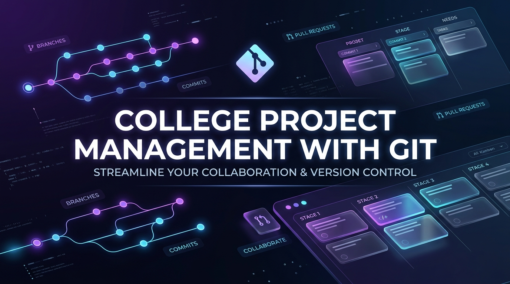

<p align="center">
  
</p>

<h1 align="center">🎓 College Project Management with Git</h1>

<p align="center">
  <strong>A modern, standardized Git framework and workflow designed for college capstone teams, academic projects, and student developers.</strong>
</p>

<p align="center">
  
  
  
  
  
</p>

---

## 📌 Overview

Academic software engineering projects often struggle with chaotic versioning, accidental overwrites, missing commit histories, and stressful submission deadlines.

**College Project Management with Git** provides a structured, industry-standard roadmap for student teams to plan, develop, and deliver collegiate engineering and computer science projects seamlessly using Git, GitLab, and GitHub.

---

## 🌟 Key Highlights

- **👥 Multi-Member Collaboration**: Clear branch ownership, isolated feature workflows, and no accidental overwrites on `main`.
- **🌿 Git Flow for Academic Sprints**: Tailored branch lifecycles aligned with college review milestones (Review 1, Review 2, Final Defense).
- **📝 Traceable Accountability**: Clear commit attribution so professors, guides, and evaluators can verify individual contributions.
- **🛡️ Merge Request / PR Reviews**: Peer reviews and mentor sign-offs before merging into production-ready code.
- **📂 Clean Academic Project Architecture**: Standardized directories separating source code, documentation, reports, datasets, and presentation decks.

---

## 🌳 Recommended Branching Strategy

```text
main (stable, release-ready submissions)
 └── develop (integration & testing branch)
      ├── feature/user-authentication
      ├── feature/ml-model-training
      ├── feature/api-endpoints
      └── docs/project-report-v1
```

| Branch | Purpose | Protection Rule |
| :--- | :--- | :--- |
| `main` | Production-ready deliverable shown during project evaluations and final defense | Protected (Merge only via PR/MR) |
| `develop` | Ongoing integration branch where team features meet | Protected |
| `feature/<name>` | Individual teammate task development | Push allowed by assigned member |
| `bugfix/<name>` | Rapid fixes for failing features during sprint milestones | Temporary branch |
| `docs/<name>` | Project documentation, SRS, design diagrams, reports | Push allowed |

---

## 🚀 Quick Start Guide

### 1. Clone the Repository
```bash
git clone https://github.com/Sachinxcode-01/gitlab-projects.git
cd gitlab-projects
```

### 2. Configure Your Git Identity (College Email)
```bash
git config user.name "Your Name"
git config user.email "your.college.email@college.edu"
```

### 3. Create and Switch to a Feature Branch
```bash
# Always branch off the latest develop branch
git checkout develop
git pull origin develop

# Create your dedicated feature branch
git checkout -b feature/module-name
```

### 4. Commit Changes with Conventional Commits
Use descriptive, standard commit messages:
```bash
git add .
git commit -m "feat(auth): implement JWT token verification logic"
```

Common commit prefixes:
- `feat`: A new feature or module implementation
- `fix`: A bug fix or patch
- `docs`: Documentation, README, or report updates
- `refactor`: Code reorganization without functional changes
- `test`: Adding or updating test cases
- `chore`: Build scripts, dependencies, or configuration changes

### 5. Push and Open a Pull/Merge Request
```bash
git push -u origin feature/module-name
```
Then navigate to your repository platform (GitLab/GitHub) and open a **Merge Request (MR)** or **Pull Request (PR)** targeting `develop`.

---

## 📁 Suggested Academic Project Directory Structure

```plaintext
├── docs/                 # SRS documents, architecture diagrams, UML diagrams
├── reports/              # Phase-wise reports (Phase 1, Phase 2, Final Thesis)
├── presentation/         # PPT slides for milestone reviews
├── src/                  # Source code for applications / backend / frontend
│   ├── backend/          # Server, API, or database layer
│   └── frontend/         # User interface & web assets
├── tests/                # Unit tests, integration tests, mock data
├── .gitignore            # Ignored binaries, node_modules, .env, OS cache
├── assets/               # Repository banners, badges, figures
├── LICENSE               # Open source license
└── README.md             # Primary repository documentation
```

---

## 📋 Evaluation & Milestone Checklist

- [ ] Repository setup with branch protection on `main`
- [ ] Team members added with appropriate access rights (Maintainer / Developer)
- [ ] Proper `.gitignore` added (no credentials, API keys, or bulky virtual environments)
- [ ] Meaningful commit messages throughout the development cycle
- [ ] All milestone deliverables tagged with Git tags (e.g., `git tag -a v1.0-review1 -m "Review 1 Submission"`)
- [ ] Final project report and slides committed in `docs/` and `presentation/`

---

## 🤝 Team Contribution Guidelines

1. **Never commit directly to `main`**: Always use feature branches and merge requests.
2. **Sync frequently**: Run `git pull origin develop` daily to minimize merge conflicts.
3. **Keep commits atomic**: Small, frequent commits are easier to evaluate than one massive 10,000-line commit.
4. **Clean up dependencies**: Ensure all third-party libraries are documented in `requirements.txt`, `package.json`, or equivalent environment configs.

---

## 📄 License

Distributed under the MIT License. See `LICENSE` for more information.

---

<p align="center">
  Crafted with ❤️ for student developers & engineering project teams.
</p>
